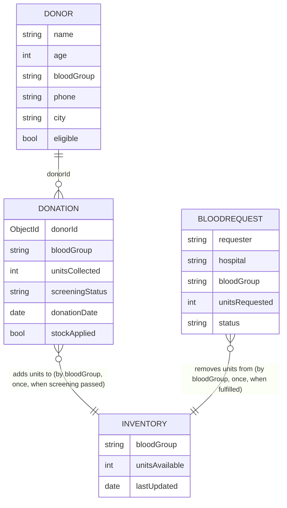

# Blood Bank Management System

College Database Systems project: Node.js + Express + MongoDB (Mongoose) with a plain HTML/CSS/JS frontend.
All data is fictional. **Not for real medical or clinical decisions.**

## Run it

```bash
npm install
# Option A: no MongoDB installed -> temporary in-memory database with sample data
#   set USE_MEMORY_DB=true in backend/.env, then:
npm start            # http://localhost:5000
# Option B: local MongoDB or Atlas -> put the connection string in backend/.env (MONGO_URI)
npm run seed         # optional sample data
npm start
npm test             # 22 automated API tests (in-memory MongoDB)
```

`backend/.env` is git-ignored; copy `backend/.env.example`. Never put database credentials in frontend code.

**Login:** the whole API (except `/api/health`) needs an admin login. Defaults are `admin` / `admin123`; change `ADMIN_USER`, `ADMIN_PASSWORD` and `SESSION_SECRET` in `backend/.env`. Tokens are HMAC-signed and expire after 8 hours; 10 failed logins per IP per 10 minutes are blocked. Security headers (CSP, nosniff, frame deny) are set on every response. The app serves its own frontend, so CORS is not enabled.

## Pages
Dashboard (totals), Donors (CRUD, search by name / blood group / city, record donations, screening), Inventory (8 ABO/Rh groups with Low/Adequate/Good), Requests (create, approve, reject, fulfil).

## Data model (ER diagram)



| Collection | Validation | Indexes |
|---|---|---|
| donors | age 18-65, bloodGroup in 8 groups, phone 10 digits | bloodGroup, city, unique phone |
| donations | 1-2 whole units, screening pending/passed/failed | donorId, screeningStatus |
| inventory | unique bloodGroup, units >= 0 | unique bloodGroup |
| bloodRequests | 1-20 whole units, status pending/approved/rejected/fulfilled | status, (bloodGroup, status) |

Sample documents:
```json
{ "name": "Arun Kumar", "age": 24, "bloodGroup": "O+", "phone": "9876543210", "city": "Chennai", "eligible": true }
{ "bloodGroup": "O+", "unitsAvailable": 25, "lastUpdated": "2026-10-22T00:00:00Z" }
```

## Stock rules (consistency)
- Submitting or approving a request **never** changes stock.
- Stock increases only when a donation's screening becomes `passed`, once (atomic `pending -> passed` claim + `stockApplied` flag).
- Stock decreases only when a request becomes `fulfilled`, once: the status change is an atomic claim (`findOneAndUpdate` on the current status), and the deduction is a single conditional update (`unitsAvailable >= n`). Insufficient stock gives HTTP 409 and the request stays `approved`.
- Allowed request transitions: pending -> approved/rejected; approved -> fulfilled/rejected.
- A donor with donation records cannot be deleted.

## REST API
`/api/donors` (POST, GET `?q=&bloodGroup=&city=`, GET/PUT/DELETE `/:id`), `/api/donations` (POST, GET, PATCH `/:id/screening`), `/api/inventory` (GET, aggregation), `/api/requests` (POST, GET `?status=`, PATCH `/:id/status`), `/api/dashboard` (GET, aggregation).

## Example queries (mongosh equivalents)
```js
db.donors.find({ bloodGroup: "O+" })                         // search by blood group
db.bloodrequests.find({ status: "pending" })                 // pending requests
db.inventories.aggregate([{ $group: { _id: "$bloodGroup", units: { $sum: "$unitsAvailable" } } }])
db.bloodrequests.aggregate([{ $group: { _id: "$status", count: { $sum: 1 } } }])
```

Test report: [docs/test-report.md](docs/test-report.md). Collection names are Mongoose defaults (lower-cased plural).
